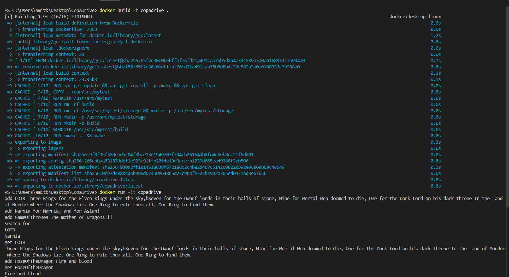

# CopaDrive

# Running with Docker:

docker build -t copadrive .
docker run -it copadrive

# Running with file persistence (files saved on the host under the storage folder):

Windows:
docker run -it -v "%cd%/storage:/usr/src/mytest/storage" copadrive

Linux / macOS:
docker run -it -v "$(pwd)/storage:/usr/src/mytest/storage" copadrive

# About the Application
CopaDrive is a command-line application that manages compressed files using RLE.
The program receives commands from the user, processes them, and stores all files inside a directory defined by the PATH_DIR environment variable.

The application supports three operations:
- add <filename> <text>: compresses the given text using RLE and saves it as a file.
- get <filename>: reads the compressed file, decompresses it, and prints the original content.
- search <content>: scans all stored files, decompresses them, and prints the names of all files that contain the given content.

The system is designed using SOLID principles and the Command design pattern.
The application runs inside a Docker container.

# Run Examples

