## CopaDrive
## About the Application
This application is inspired by Google Drive, but built with our own design and custom features.
It includes user registration and login, file uploads, and a variety of actions you can perform on your files—all through a clean, calm, and user-friendly interface.
Static data is stored and served by the web server, while the actual file content is stored and managed by our C++ server.
Our UI email field supports addresses in the format **xxx@copa.com**, matching the branding of the application.

- **NodeJS Web Server (REST API)** 
handles user management, authentication using JWT, file metadata, and access permissions

- **C++ TCP Storage Server** 
stores and retrieves the compressed file content. The NodeJS server connects to it as a TCP client whenever file content needs to be uploaded, downloaded, or searched, and receives the result back for the API response.

### Main Features
- **Users & Authentication**
  - Register a new account
  - Login (JWT-based authentication)
  - View and edit user profile details

- **Files & Folders**
  - Upload files of any type
  - Download files
  - Edit/update file content
  - Create folders
  - Rename files and folders
  - View file details (creation/upload date, last opened)
  - Recents / frequently used files view
  - Multiple view modes (grid/list)

- **Search**
  - Search by file/folder name
  - Search inside file content (content search)

- **Organization & Labels**
  - Star files (favorites)
  - Mark files as important

- **Trash**
  - Move items to trash and restore them
  - Items in trash are permanently deleted after 30 days
  - Trash view displays how many days remain until permanent deletion

- **Sharing & Permissions**
  - Share files/folders with other users
  - Role-based permissions: Viewer / Editor / Owner
  - Only authorized users can view/edit based on their role

- **Storage & System**
  - Real storage usage display (actual size/quota view)
  - Static data is served by the NodeJS Web Server
  - File content is stored and retrieved via the C++ TCP Storage Server

- **UI / Experience**
  - Day/Night theme toggle
  - Background music player (PlaySong)
  - Calm, modern, and user-friendly interface

### Notes
- Authentication is handled using JWT.
- The NodeJS Web Server (REST API) manages users, auth, file/folder metadata, search, sharing, and permissions.
- The C++ TCP Storage Server stores and retrieves compressed file content; NodeJS connects to it as a TCP client for upload/download/content-search operations.
- We set **main4** as the default branch and froze **main3** so the Exercise 3 server remains unchanged.

### Prerequisites
- Docker Desktop
- Node.js (LTS) + npm

### Environment Setup (Required)
**Rename**: web-server/.env.example → web-server/.env
Open web-server/.env and set your own secret: **JWT_SECRET**="your-own-strong-secret"

### Run Instructions (PowerShell)
- From the project root: `docker compose up --build`
- open it in your browser http://localhost:4000 Or Ctrl + Click the URL in the terminal.

### App Run Example

**Loading page**

**Login page**

**Dark mode login page**

**First register page**

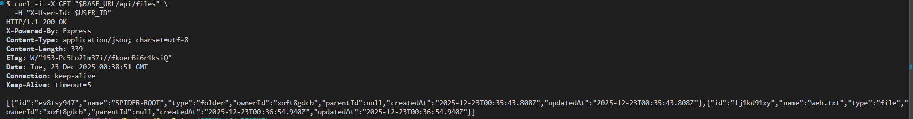

**Second register page**

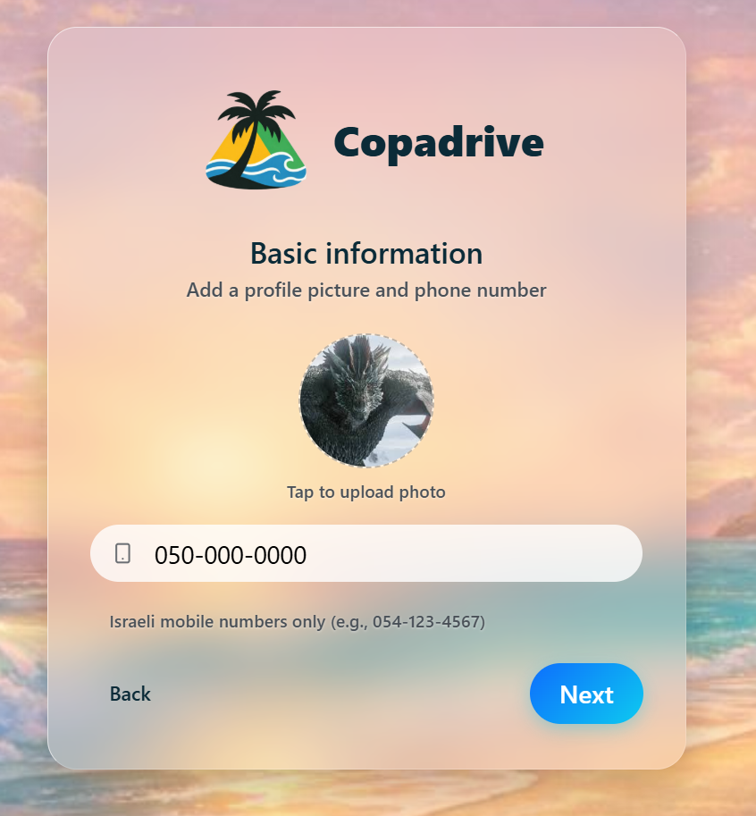

**Third register page**

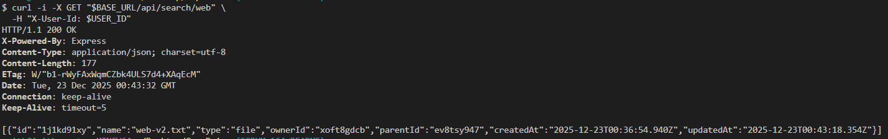

**Phone validation register page**

**Date validation register page**

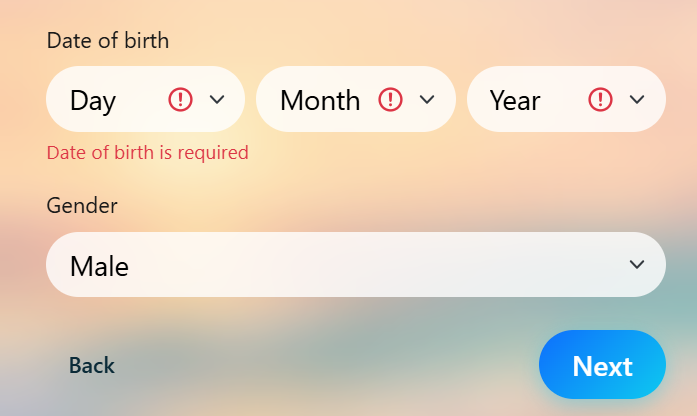

**Fourth register page**

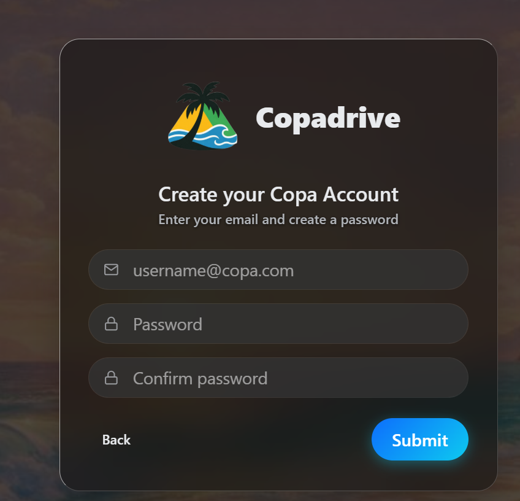

**Email and password instructions**

**Email and password validation**

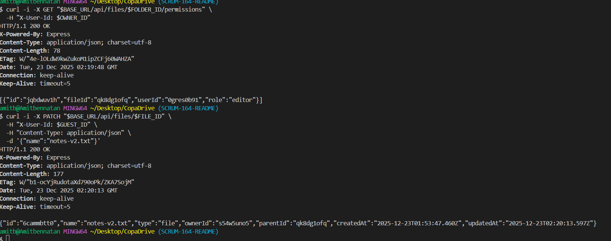

**Email availability check**

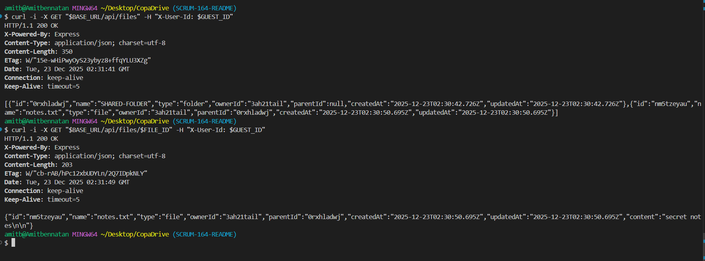

**Registration confirmation page**

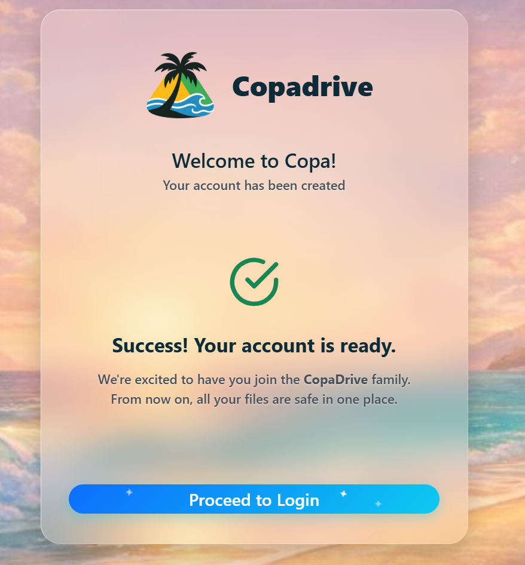

**Sign in with an existing account**

**Home page**

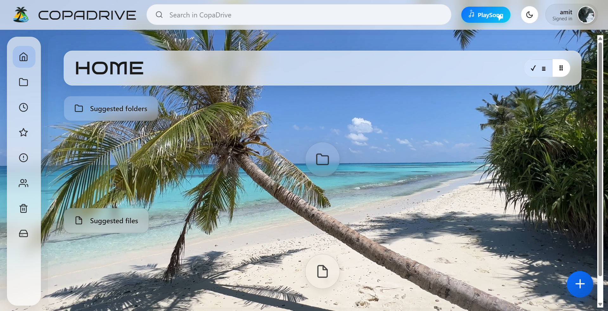

**Dark mode Home page**

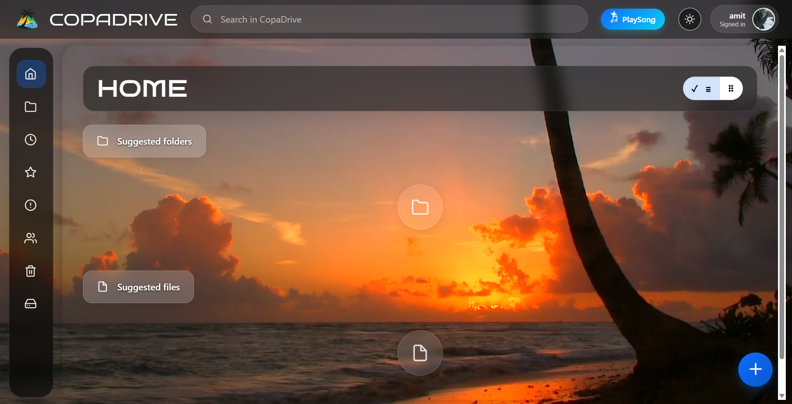

**Dark mode, music, and profile button**

**Edit profile**

**Password change availability**

**“Are you sure?” screen**

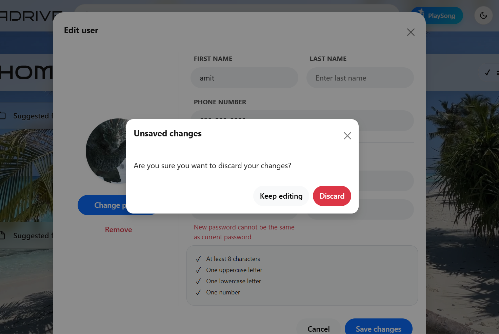

**Add button**

**Upload a file from your computer**

**Upload an MP4 file**

**Upload an image**

**Create a file inside a folder**

**Support for a wide variety of file types**

**Option to move a file to a different location**

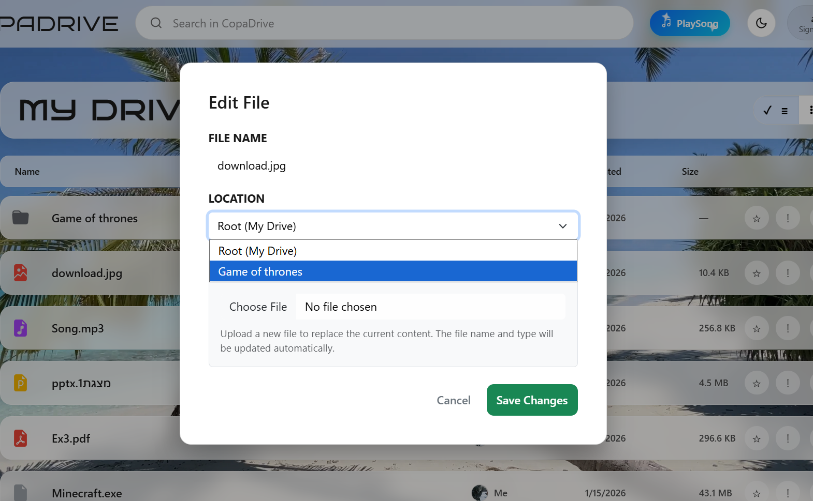

**View a file and access a variety of actions/options**

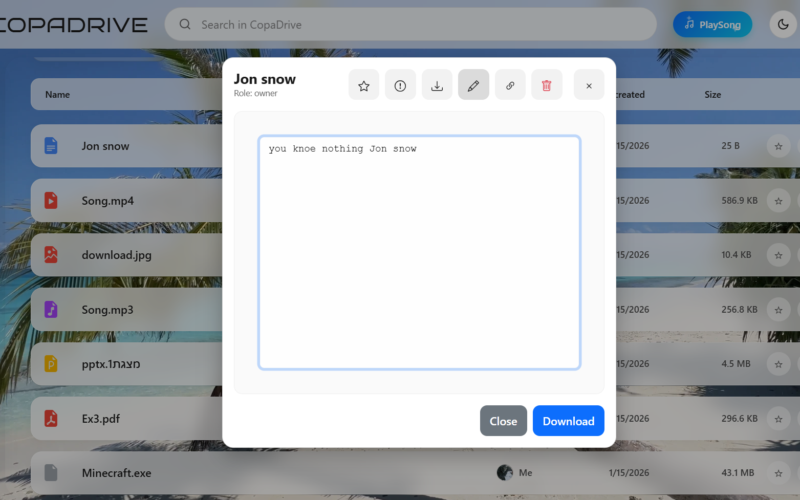

**File sharing**

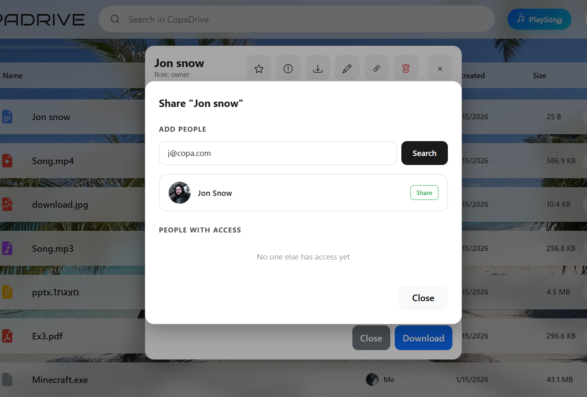

**Permission management (viewer/editor/remove access)**

**My drive page**

**Grid view mode**

**Recent files page**

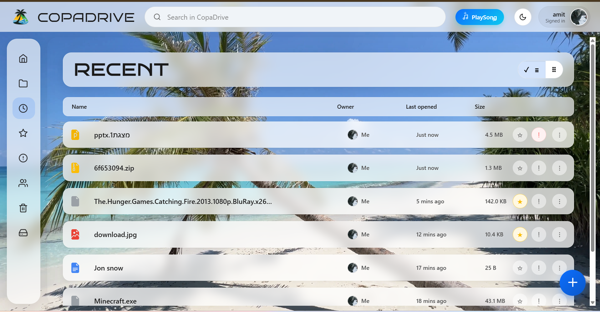

**Starred files page**

**Important files page (dark mode)**

**Files shared from another user**

**Trash page with restore options, a “days remaining” indicator, and an option to empty the trash**

**Storage page (15GB limit indicator)**

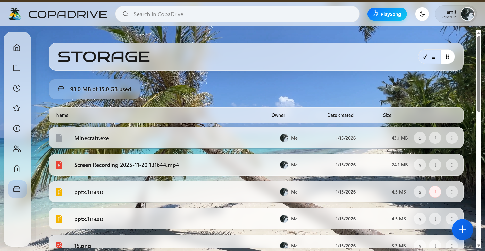

**Sidebar navigation with a storage meter and quick access to all pages**

**File search**

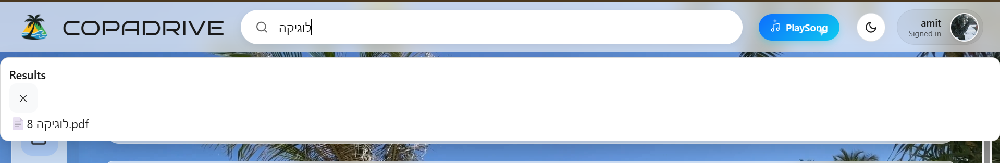

**Folder search**

**File editor page**

**Share a file with another user as a viewer**

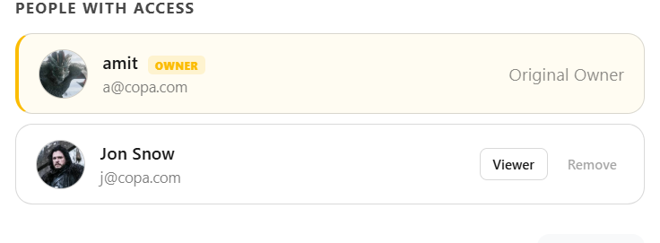

**Viewer cannot edit the file.**

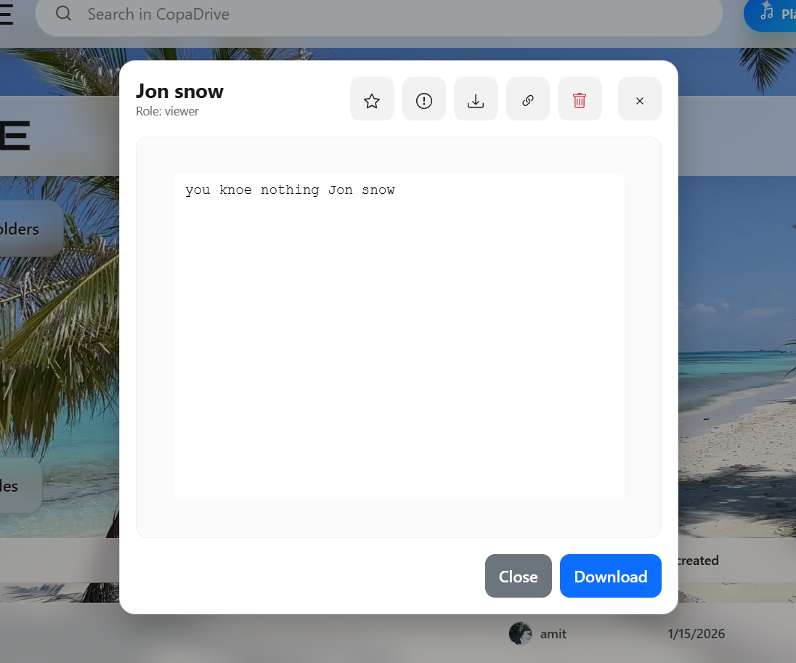

**A file received from another user**

