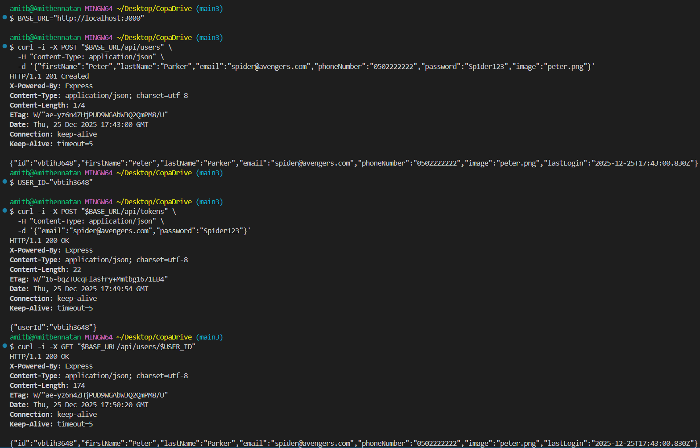
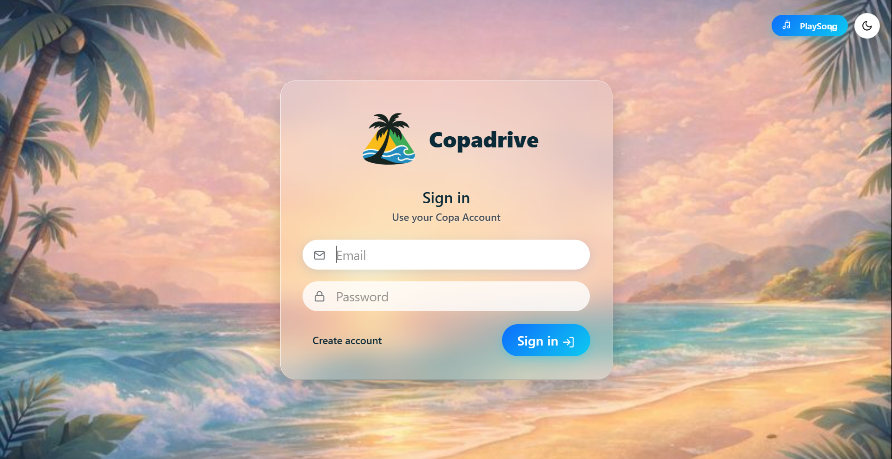
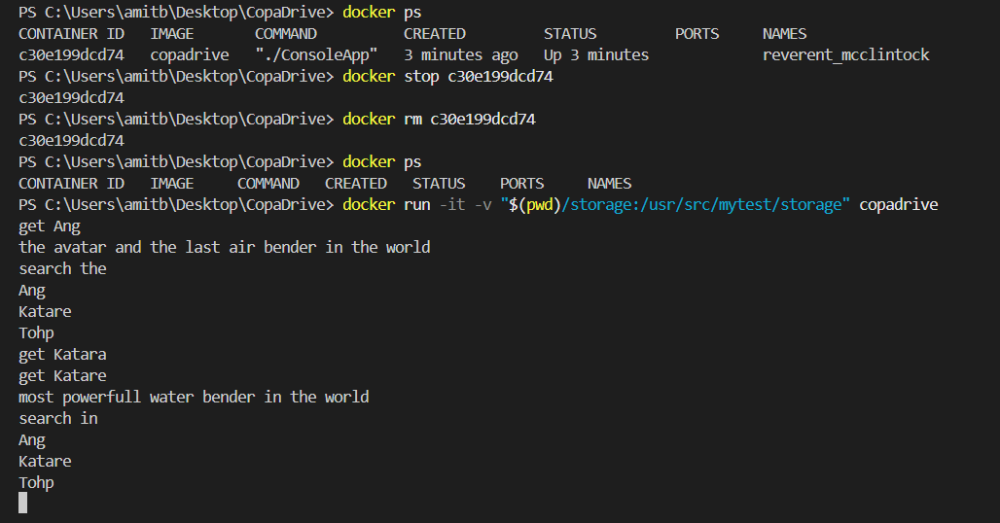
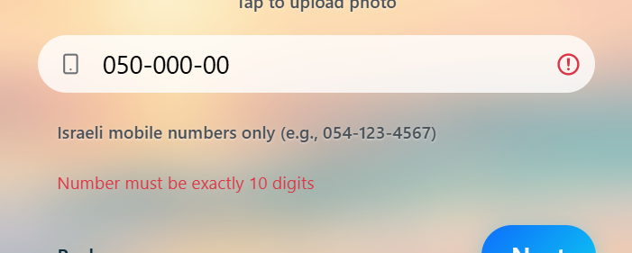
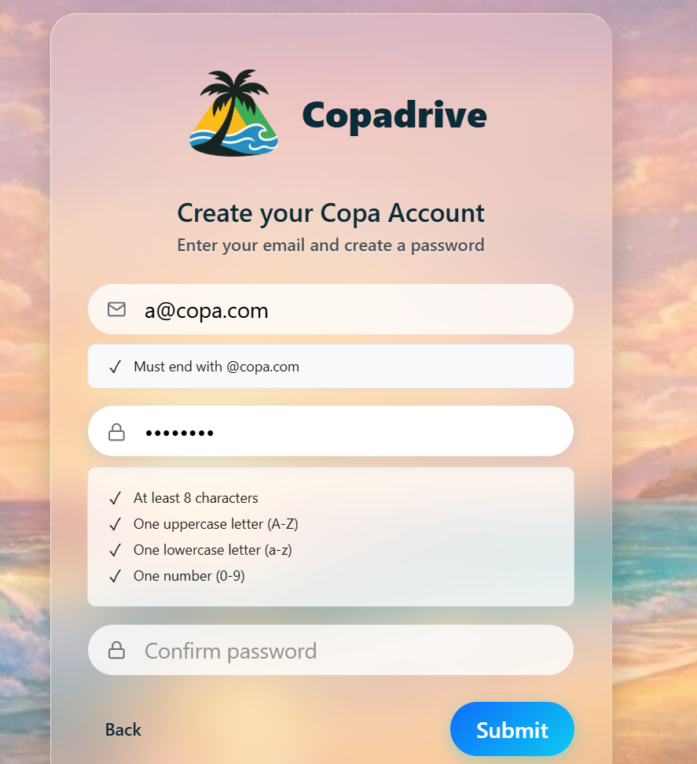

## CopaDrive
## About the Application
The app is split into two cooperating servers:
- **NodeJS Web Server (REST API)** – handles users, authentication, files metadata and permissions
- **C++ TCP Storage Server** – stores and retrieves compressed content. The NodeJS server connects to it as a TCP client whenever file content is created/read/searched
### Main Features
- **Users**
  - Register a new account
  - Login
  - Get user profile by id
- **Files & Folders**
  - Create, view, update, and delete files/folders
  - Each request operates only on items the user has permission to
  - File content is stored in the Cpp storage server and folders are metadata-only
  - Search over items the user has permission to, Matches by name and/or by file content
- **Permissions**
  - Add Permissions to files/folders to other users when default role is viewer
  - The creator is editor by default
  - Permissions can be updated (viewer ↔ editor) or revoked
  - Get Permissions to files/folders by id
### Notes
- This project uses an in-memory data store
- Authentication is done by sending the logged-in user id in the request headers
- We set **main3** as the default branch and froze main2 so the Exercise 2 server remains unchanged
### Run Instructions
The commands are tailored for: Bash shells, Git Bash and WSL
## Launching
| Command | What it does | Expected result |
|---|---|---|
|`docker compose build` |Build all Docker images (web-server, cpp-server, clients, tests) |Build succeeds |
|`docker compose up` |Run full environment |Containers start |
|`docker compose up web-server` |Run the NodeJS web server |Web server starts |
|`docker compose up cpp-server` |Run the C++ TCP server |C++ server starts |
|`docker compose run --rm cpp-client` |Run the C++ client |Client runs |
|`docker compose run --rm python-client` |Run the Python client |Client runs |
|`docker compose run --rm test` |Run the tests |Test runs |
## Commands
### Users
| Command | What it does | Expected result |
|---|---|---|
|`curl -i -X POST "..." -H "Content-Type: application/json" -d '{"firstName":"...","lastName":"...","email":"...","phoneNumber":"...","password":"...","image":"..."}'` |Register a new user |`201 Created` + user JSON (without password) |
|`curl -i -X GET "..."` |Get user profile by user id |`200 OK` + user JSON (without password) |
|`curl -i -X POST "..." -H "Content-Type: application/json" -d '{"email":"...","password":"..."}'` |Login (username + password) |`200 OK` + `{ "userId": "..." }` |
### Files
| Command | What it does | Expected result |
|---|---|---|
|`curl -i -X GET "..." -H "X-User-Id: ..."` |List all items the user has permission to |`200 OK` + array of items |
|`curl -i -X POST "..." -H "X-User-Id: ..." -H "Content-Type: application/json" -d '{"name":"...","type":"file/folder","parentId":"...","content":"..."}'` |Create a new file/folder under `parentId` (or root if `parentId` is `null`) |`201 Created` + created item |
|`curl -i -X GET "..." -H "X-User-Id: ..."` |Get file/folder by id | `200 OK` + item JSON |
|`curl -i -X PATCH "..." -H "X-User-Id: ..." -H "Content-Type: application/json" -d '{"name":"...","parentId":"..."}'` |Update a file/folder (rename/move/content) | `200 OK` + updated item |
|`curl -i -X DELETE "..." -H "X-User-Id: ..."` |Delete a file/folder (folders are deleted recursively). |`204 No Content` |
|`curl -i -X GET "..." -H "X-User-Id: ..."` |Search files/folders the user has permission to (matches by name and/or content) |`200 OK` + array of matching items |
### Permissions
| Command | What it does | Expected result |
|---|---|---|
|`curl -i -X GET "..." -H "X-User-Id: ..."` |List permissions for a file/folder |`200 OK` + array of permissions |
|`curl -i -X POST "..." -H "X-User-Id: ..." -H "Content-Type: application/json" -d '{"userId":"..."}'` | Create a new permission for a file/folder Default is `viewer` | `201 Created` + created permission |
|`curl -i -X PATCH "..." -H "X-User-Id: ..." -H "Content-Type: application/json" -d '{"role":"viewer/editor"}'` | Update an existing permission between `viewer` and `editor` |`200 OK` + updated permission |
|`curl -i -X DELETE "..." -H "X-User-Id: ..."` |Revoke permission (remove access) for a user from a file/folder. |`204 No Content` |
### Error Handling
| Area  | When it happens  | What is returned |
|---|---|---|
| Global        | JSON body (bad JSON)                                      | `400` + `{ "error": "Invalid JSON format", "status": 400 }`                          |
| Auth          | Missing `X-User-Id` (or missing `Authorization: Bearer ...`)        | `401` + `{ "error": "Authentication required", "status": 401 }`                      |
| Auth          | `X-User-Id` provided but user does not exist                        | `401` + `{ "error": "Invalid user ID", "status": 401 }`                              |
| Users         | Missing required registration field                                 | `400` + `{ "error": "<Field> is required", "status": 400 }`                          |
| Users         | `image` is not a non-empty string                                   | `400` + `{ "error": "image must be a non-empty string", "status": 400 }`             |
| Users         | Register with an already used username                              | `409` + `{ "error": "Username already taken", "status": 409 }`                       |
| Users         | Register with an already used email                                 | `409` + `{ "error": "Email already registered", "status": 409 }`                     |
| Users         | Register with a password that already exists                        | `409` + `{ "error": "Password must be unique among users", "status": 409 }`          |
| Users         | Login with wrong username/password                                  | `401` + `{ "error": "Invalid credentials", "status": 401 }`                          |
| Users         | Get user by id that doesn’t exist                                   | `404` + `{ "error": "User not found", "status": 404 }`                               |
| Files         | Create item: missing/empty `name`                                   | `400` + `{ "error": "Name is required", "status": 400 }`                             |
| Files         | Create item: invalid `type`                                         | `400` + `{ "error": "Type must be \"file\" or \"folder\"", "status": 400 }`          |
| Files         | Create item: `parentId` provided but parent not found               | `404` + `{ "error": "Parent folder not found", "status": 404 }`                      |
| Files         | Create item: parent exists but is not a folder                      | `400` + `{ "error": "Parent must be a folder", "status": 400 }`                      |
| Files         | Get item by id but user has no permission                           | `403` + `{ "error": "Access denied", "status": 403 }`                                |
| Files         | Get/Update/Delete: item id not found                                | `404` + `{ "error": "File or folder not found", "status": 404 }`                     |
| Files         | PATCH: body missing / invalid JSON body                             | `400` + `{ "error": "Invalid JSON body", "status": 400 }`                            |
| Files         | PATCH: trying to update `type`                                      | `400` + `{ "error": "Type cannot be updated", "status": 400 }`                       |
| Files         | PATCH: invalid `name`                                               | `400` + `{ "error": "Name must be a non-empty string", "status": 400 }`              |
| Files         | PATCH: `parentId` equals the item id                                | `400` + `{ "error": "parentId cannot be the same as id", "status": 400 }`            |
| Files         | PATCH move: moving folder into its descendant                       | `409` + `{ "error": "Cannot move a folder into its own descendant", "status": 409 }` |
| Permissions   | Permissions actions when file not owned by user / or not found      | `404` + `{ "error": "File not found or access denied", "status": 404 }`              |
| Permissions   | POST permission: missing `userId`                                   | `400` + `{ "error": "UserId is required", "status": 400 }`                           |
| Permissions   | PATCH/DELETE: permission id not found                               | `404` + `{ "error": "Permission not found", "status": 404 }`                         |
| Storage (TCP) | Storage server unavailable / connection error                       | `503` + `{ "error": "Storage server unavailable", "status": 503 }`                   |
| Storage (TCP) | Storage returns error status (illegal command / missing file) | `<status>` + `{ "error": "<storage status line>", "status": <status> }`              |
| Files         | File exists in metadata but content missing in storage              | `200` + item JSON with `content: ""`                                                 |
| Search        | Content-search on storage returns 404                               | `200` + array of matching items (name-match still works)                             |
### App Run Example
**Docker Compose Build + Up (All Services Started) + Automated 100% Passed**

**User Registration + Login + Get User Details**

**Create Folder (POST /api/files)**

**Create File with Content (POST /api/files)**

**List Accessible Items (GET /api/files)**

**Read & Update a File (GET/PATCH /api/files/:id)**

**Search Files by Name/Content (GET /api/search/:query)**

**Search Files by Content Match (GET /api/search/:query)**

**Share a Folder (Create File + Grant Permission + List Permissions)**

**Permission Upgrade (Viewer → Editor) + Guest Edit Allowed**

**Permission Revocation (Delete Share) → Guest Loses Access (403 Forbidden)**

**Folder Shared as Editor → Guest Can Edit a File Inside the Shared Folder**

**List Shared Folder + Access Shared File Content (Recursive Permissions)**

