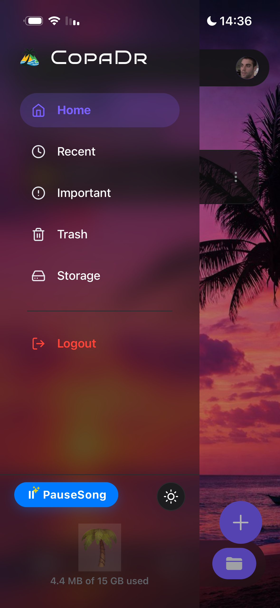
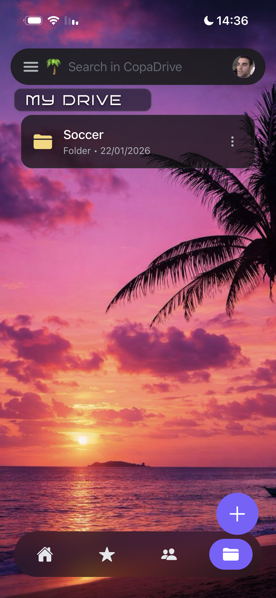

# CopaDrive - App Settings & Utilities

This section highlights the unique environment settings and storage management features of CopaDrive.

---

### Theme & Audio Controls
The application sidebar provides quick access to environment customization and music.

### Feature Highlights:

* **Play/Pause Theme Song:** A dedicated button in the header and sidebar allows users to toggle the app's tropical theme song on or off.
* **Dark Mode Toggle:** A one-tap switch to transition the entire UI between Light and Dark modes for better visibility in different lighting conditions.
* **Palm Storage Tree:** A custom visual indicator showing the remaining cloud storage space in a themed format (4.4 MB of 15 GB used).

---

### Dark Mode Experience
A showcase of the main drive interface with Dark Mode enabled, featuring high-contrast elements and the vibrant sunset background.
