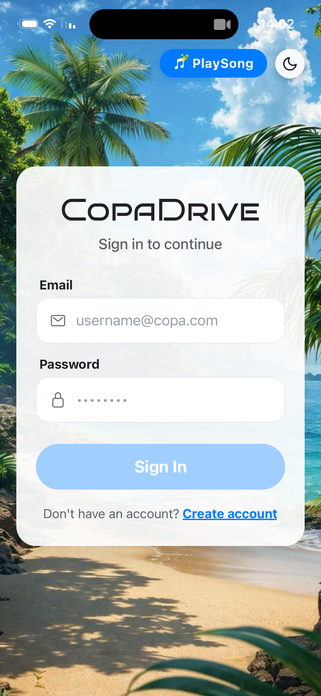
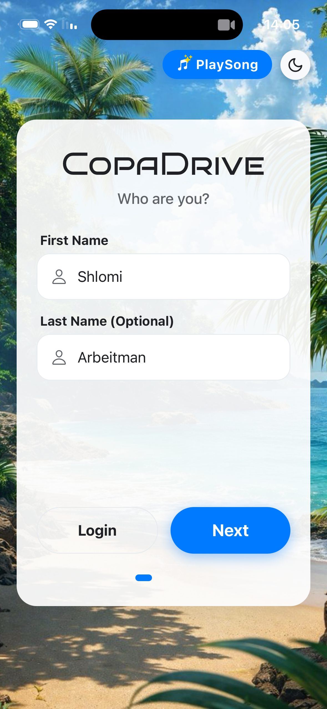
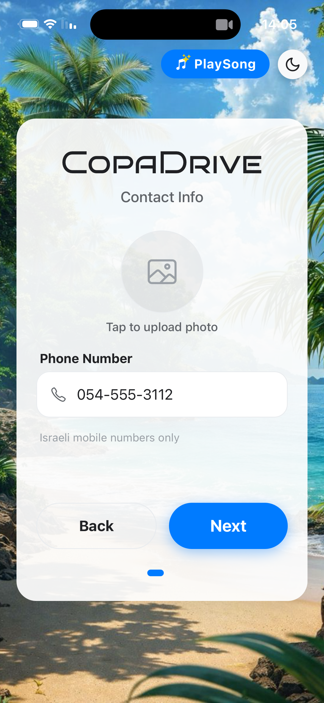
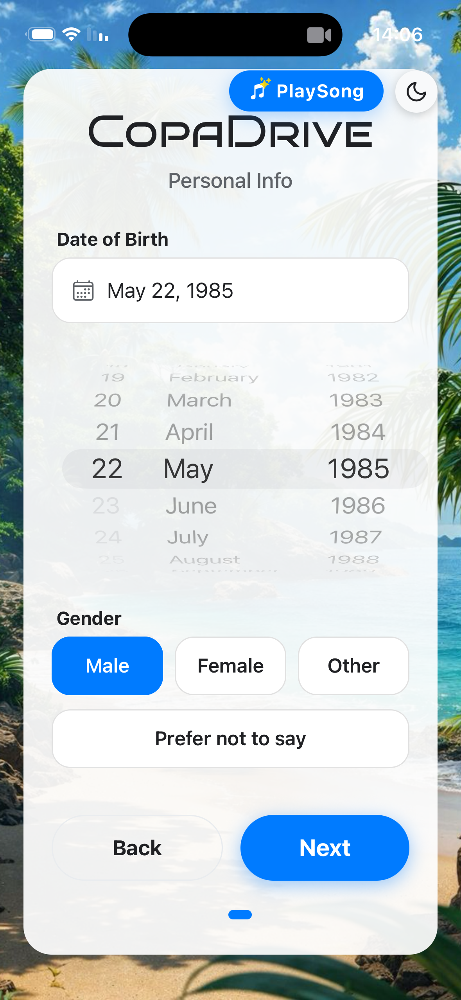
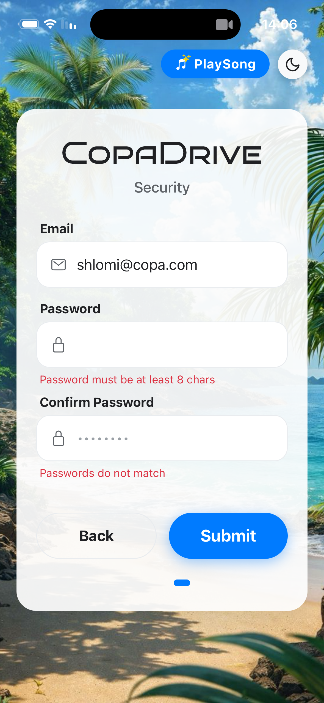
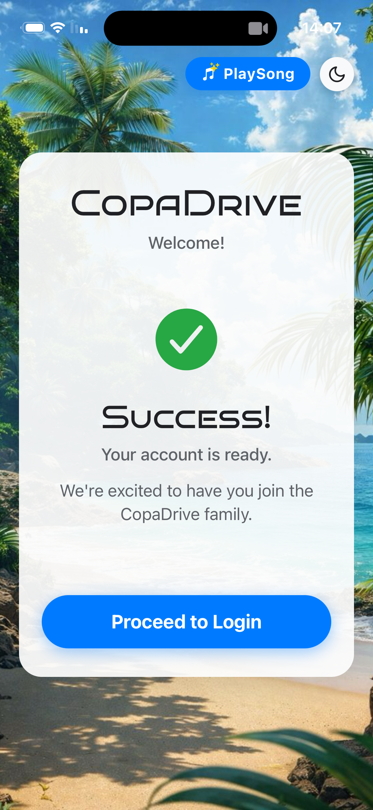
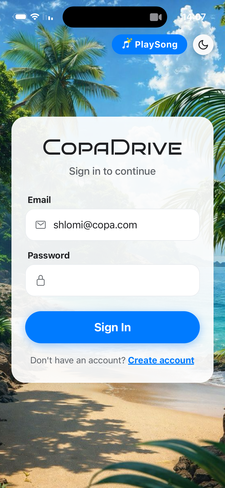

# CopaDrive - Registration & Login Flow

This guide walk through the user authentication screens of the CopaDrive application.

---

### Login Screen
Initial sign-in interface for existing users.

### Step 1: Identity
Users provide their first and last name to begin registration.

### Step 2: Contact Info
Profile picture upload and mobile number verification.

### Step 3: Personal Info
Selection of date of birth and gender.

### Step 4: Security
Account credential setup including email and password validation.

### Step 5: Success
Final confirmation screen after a successful registration.

### Post-Registration Login
Automatic redirection to login with the newly created account.
